# Standalone setup synchronization

Current interface direction: the CLI is the primary product. `sync`, `share`,
`play`, inspection and verification operate independently. The optional Qt window
invokes those public CLI operations and displays JSON progress; its main screen is
only the setup code and Sync/Play controls. Import/export and engine overrides stay
in the CLI. Chat work is deferred. See [the test scope](tests.md) and
[current SME validation](sme-validation.md).

The latest priority is [automatic setup and Play](companion.md). A separate native
friends/chat/discovery/scheduling application, `SkyrimCoopChat`, uses optional local
interfaces and has no Steam identity dependency. SkyrimCoop, the launcher, and chat
are independently usable applications. The folder-mirroring contract below remains a longer-term
capability; generalizing acquisition providers is not a prerequisite for validating
the first supported Wabbajack workflow.

The product target is: the host sends a setup file; a friend opens it, approves once,
and receives a matching isolated installation ready for a validated launch. Lengthy
downloads can run before the planned game session. SkyrimCoop owns live session state
and checks actual loaded compatibility. This utility is useful without multiplayer.

The installation contract is the effective file/config manifest, not the identity of
a mod manager. Users can satisfy it with another tool. One distinct target manifest
can serve several hosts/worlds; their mutable session state remains separate.

## Clarified product contract

The primary host input is an ordinary, working modded Skyrim game directory plus its
selected external configuration and plugin activation files. Neither the host nor
the friend needs a mod organizer. A manager-specific import is an optional convenience,
not the canonical model. Wabbajack is an optional acquisition/reconstruction provider.

The friend can create a dedicated installation or select an existing modded one.
Planning compares its contents to the host manifest, reuses matching bytes, and
identifies missing, changed and unexpected files before applying an update. Existing
installations need an explicit reviewable update plan, recoverable changes, and a
defined treatment of user settings and runtime outputs. The current prototype only
publishes new managed installations and refuses to update a changed published one.

Each desired file needs both an expected identity and an acquisition instruction.
Scanning a game folder provides paths and hashes; it does not in general reveal the
original archive, its exact version, installation options or subsequent transformations.
Acquire missing content from the friend's licensed base game, verified local files or
archives, original download sources with reconstruction instructions, or host-provided
content permitted for distribution. Unresolved content must block readiness and name
the missing acquisition information.

The intended operations remain independently usable: capture a target, plan differences,
acquire content, materialize/apply the target, verify, and launch. A desktop application
orchestrates those operations. Source discovery and providers must be separate from
the final installation contract so another acquisition tool can satisfy it.

The current Wabbajack-specific package schema and Share UI are implementation limits.
General acquisition metadata, complete ordinary-folder configuration capture, and
transactional updates to selected existing installations remain to be implemented.

## Current vertical slice

```mermaid
flowchart LR
  H[Installed host list + original recipe] --> E[Native exporter]
  E --> S[Shareable setup file]
  S --> U[Review and Install button]
  U --> W[Wabbajack-compatible reconstruction engine]
  W --> D[Materialize isolated game and config]
  D --> V[Verify all declared bytes and reject extras]
  V --> P[Publish matching installation]
  P --> L[Private Proton configuration + SKSE launch]
  L --> C[SkyrimCoop checks actual loaded state]
```

The source tree is ordinary materialized files. It does not require MO2 to build a VFS
at runtime. Standard manager conventions must be explicitly represented; unsupported
views fail export. The original licensed game supplies local base files. Original
mod downloads/reconstruction belong to an engine adapter, with account and source rules.

## Package and protocol

A `.skyrimsync` file is a ZIP with `manifest.json` and, optionally, `recipe.wabbajack`.
The descriptor pins archive identity, expected destinations and contents, and the
source paths used to materialize them. It records selected source hints for consent.
The alternative URL-addressed form contains only the compressed descriptor and retrieves
the exact pinned Wabbajack artifact later. No executable commands are accepted in it.

Each file has `path`, `size`, `sha256`, and `source: {kind, path}`. `kind` is `base`
or `wabbajack`; destinations are under `game`, `config/documents` or `config/local`.
Source paths are relative to a locally selected base or engine reconstruction root.
Limits reject ambiguous Windows names, path collisions, traversal and oversized inputs.

Setup identity hashes only canonical final paths, sizes and SHA-256 values. Display
names, recipe identity and download URLs do not affect equality. Job identity includes
the full recipe so interrupted reconstruction is tied to its actual inputs.

The CLI emits one JSON object per line and stable error codes; exit 0 is success,
2 is a refused/mismatching setup, 3 is an I/O failure, and 130 is interruption.
Persistent status and events let a frontend consume the same state. Installer logs
remain local. `files_verified` means exact declared bytes were verified; `launch_started`
means process creation, not a passed game boot or multiplayer test.

## Why reuse Wabbajack

Its existing archive acquisition, binary patches and BSA reconstruction cover difficult
parts of reproduction. Current upstream CLI exposes install/output/downloads options;
the engine is a local choice, never an executable specified by a friend. MO2-less
compilation is documented, but compatibility of each concrete list/layout/engine needs
testing. We do not claim that a Jackify AppImage is interchangeable with that CLI.

Sources inspected:

- [Wabbajack CLI install](https://github.com/wabbajack-tools/wabbajack/blob/2eb8cf423e233bad396fb133d00e6c6de4cb4808/Wabbajack.CLI/Verbs/Install.cs).
- [MO2-less compilation](https://wiki.wabbajack.org/modlist_author_documentation/Native-Game-Installer%20-%20%28Installers%20not%20using%20MO2%29.html).
- [MO2 priority serialization](https://github.com/ModOrganizer2/modorganizer/blob/4ba22f0d8b6f9e08e44008b8395cd774551b4ebe/src/profile.cpp#L258).
- [Wabbajack CDN part protocol](https://github.com/wabbajack-tools/wabbajack/blob/2eb8cf423e233bad396fb133d00e6c6de4cb4808/Wabbajack.Downloaders.WabbajackCDN/WabbajackCDNDownloader.cs).
- [Nexus application policy](https://help.nexusmods.com/article/114-api-acceptable-use-policy).

## Acceptance before calling it ready to play

Use a supported real pack on two machines. Export the host target, reconstruct and
materialize the friend target, compare in-process effective manifests, and boot through
the actual launch adapters. Test missing entitlement, interrupted transfers, closed
host, changed target, modified installation and return to personal play. Compare files,
activation and relevant effective settings. A real recipe-format inspection or a fake
backend cannot substitute for this acceptance test.
